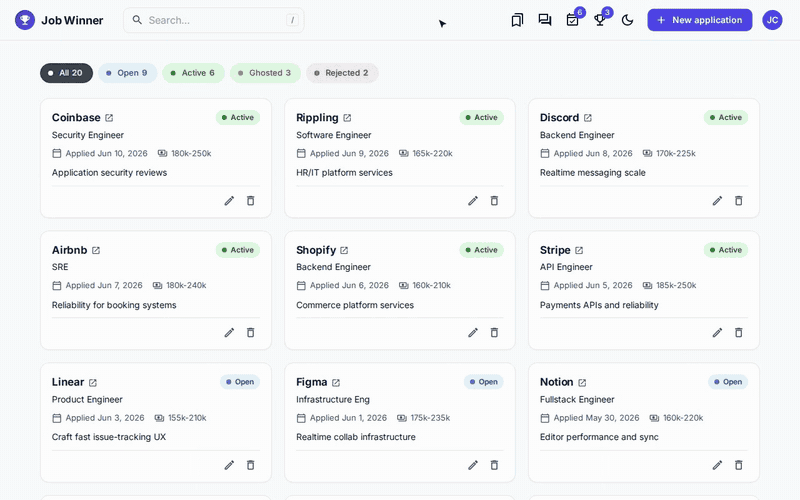
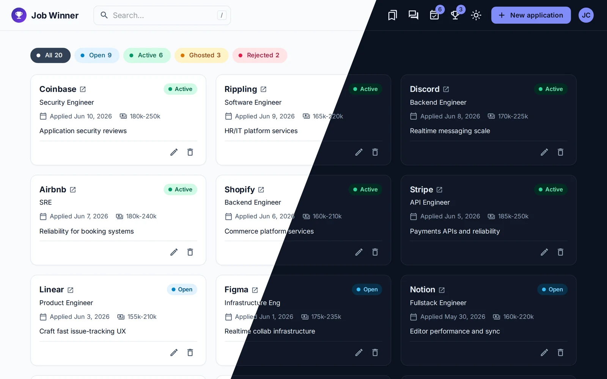
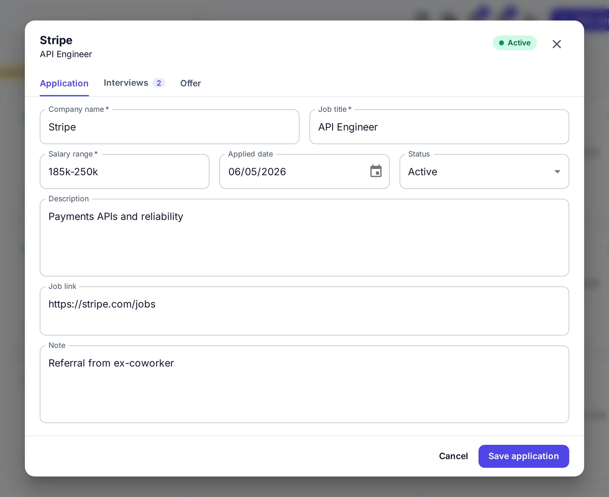
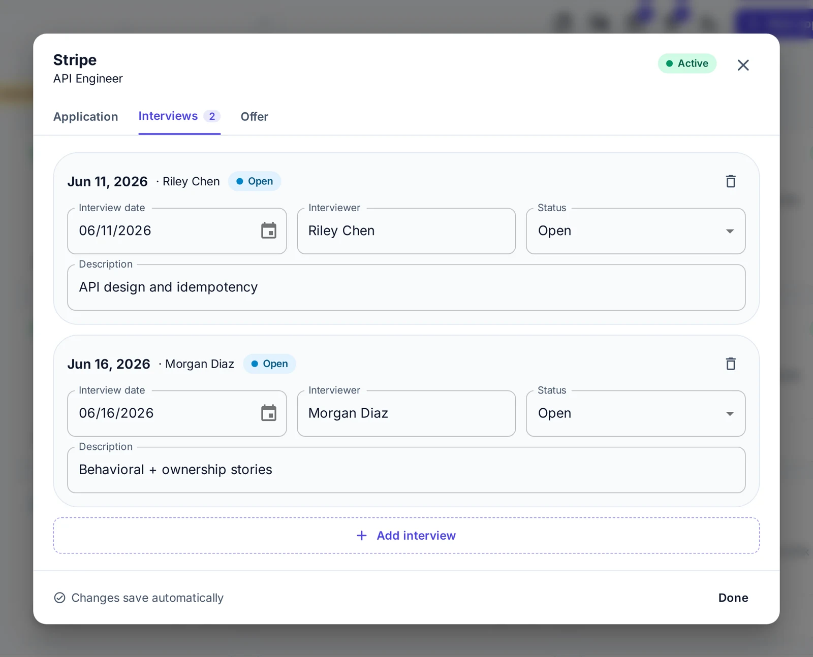
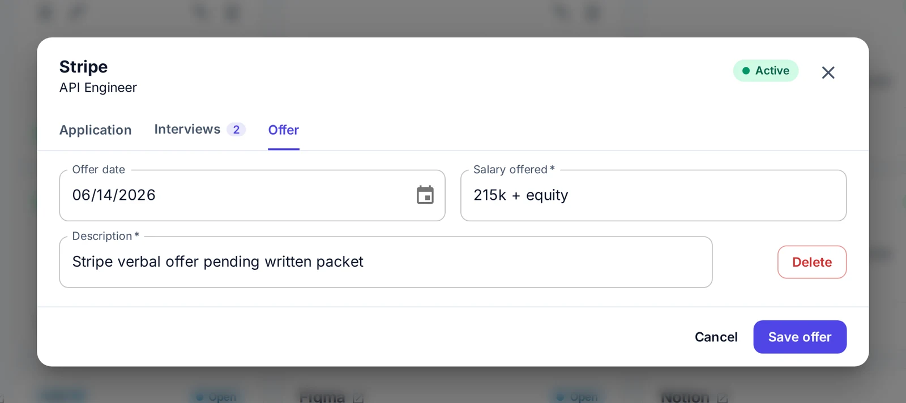
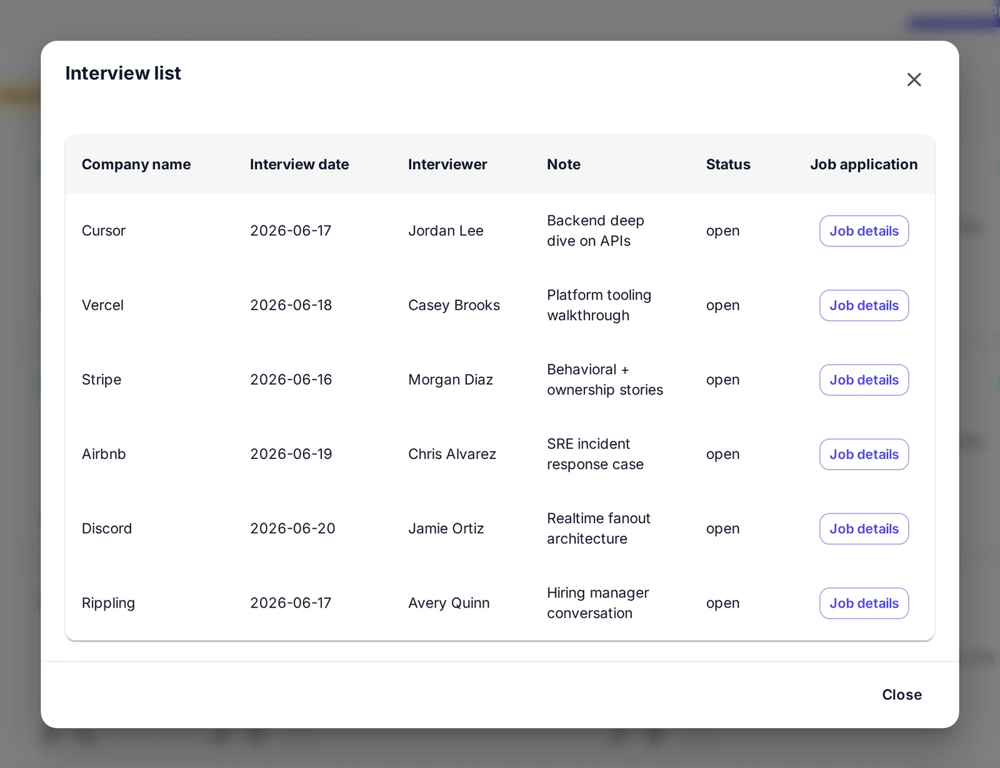
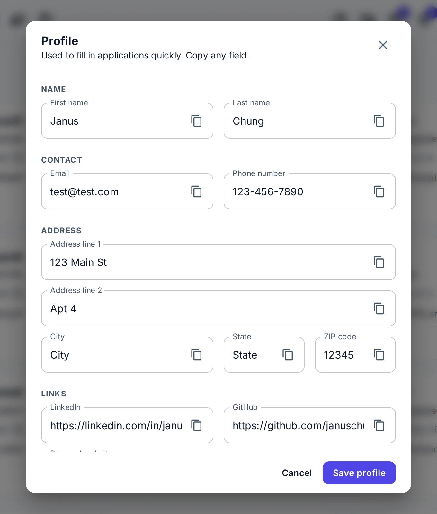
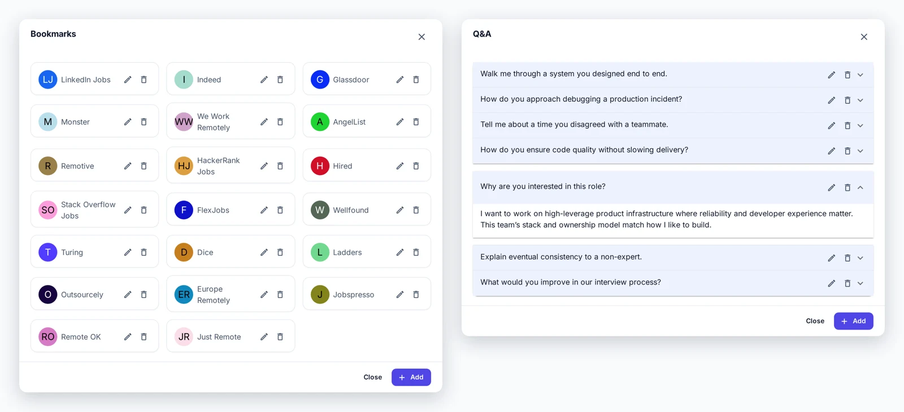
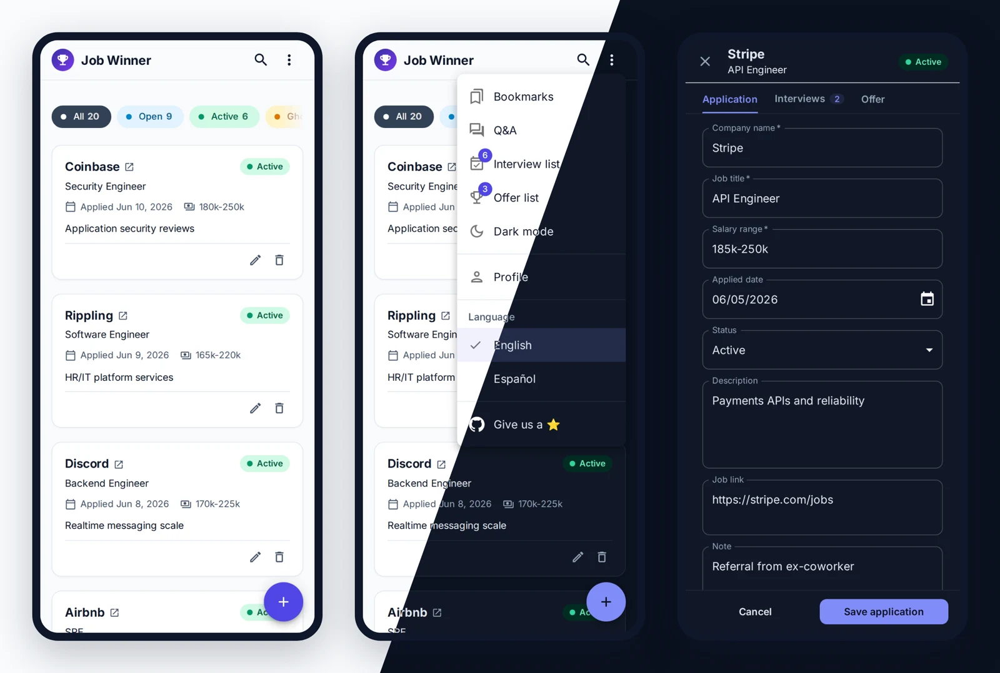

# Job Winner

<p align="center">
      
</p>

## Live Demo

🚀 Check out the live demo! 👉 https://jobwinner.duckdns.org

✨ The data refreshes automatically every hour, so feel free to explore and test out any feature!

Let me know if you'd like any further tweaks by submitting an issue!

## Background

I lost my job right before the holiday season in 2022. I need to look for a new job and apply for as many as I can while all the big techs are laying off talents.

To keep track of job applications:

1. Use Google Spreadsheet (I am using it before this project). It is ugly, hard to maintain and easy to mess up the layout.
1. Use online tool like huntr.co. But it can only track 40 jobs and I don't want to spend a dime for the premium service.
1. Use pen and paper. It works but I can't copy and paste information such as the job url link and utilize it later.

None of the about is fun or totally fit my use case.

That's the reason for me to build something for myself, and potentially you, to get the job done (and to get a new job successfully!)

## Benefit of Job Winner

Job Winner helps you keep track of all your job applications in one place—totally free! No hidden fees, and you won't have to worry about your personal data being sold.

One of the handy features is the Profile Page. This is where you can store all the personal information that job applications often ask for (like your LinkedIn URL). Plus, it has a super handy feature that lets you copy any field to your clipboard with just a click.

## Features

Screenshots below follow your GitHub theme (light or dark).

1. **Board:**

   All your applications in one place, most actionable first. Filter by status with the chips, or search by company, job title or description (press `/` to jump to search). Light and dark mode.

   

1. **Add, edit and delete applications:**

   Track the company, title, salary range, applied date, status, job link and notes.

   <picture>
     <source media="(prefers-color-scheme: dark)" srcset="readme-img/application-dark.webp">
     
   </picture>

1. **Interviews:**

   Each application keeps its interviews: date, interviewer, status and notes. Changes save automatically.

   <picture>
     <source media="(prefers-color-scheme: dark)" srcset="readme-img/interviews-dark.webp">
     
   </picture>

1. **Offer:**

   Record an offer's date, salary and details against the application.

   <picture>
     <source media="(prefers-color-scheme: dark)" srcset="readme-img/offer-dark.webp">
     
   </picture>

1. **Interview list and offer list:**

   Upcoming interviews and all offers across applications, with sortable columns. The header badges show how many of each you have.

   <picture>
     <source media="(prefers-color-scheme: dark)" srcset="readme-img/interview-list-dark.webp">
     
   </picture>

1. **Profile:**

   Store the personal details applications keep asking for (address, phone, LinkedIn and more) and copy any field with one click.

   <picture>
     <source media="(prefers-color-scheme: dark)" srcset="readme-img/profile-dark.webp">
     
   </picture>

1. **Bookmarks and Q&A:**

   Keep your favourite job boards a click away, and your answers to common interview questions ready to reuse.

   <picture>
     <source media="(prefers-color-scheme: dark)" srcset="readme-img/collections-dark.webp">
     
   </picture>

1. **Mobile, and in Spanish:**

   Works on phones, and the whole app is available in English and Spanish.

   

## Components

Job Winner has two components

1. UI (this repo)
1. [Backend](https://github.com/januschung/job-winner)

## About this repo

This is the UI for Job Winner and here is the stack:

1. React 19
1. Apollo Client 4
1. Material UI 9
1. Vite

## To build

Please follow the build instruction from the [Backend repo](https://github.com/januschung/job-winner) to bring up the backend.

```console
npm run dev
```

or use docker

```console
docker build -t job-winner-ui .
docker run -p 3000:3000 -d job-winner-ui
```

### Run without the backend

For UI work you can skip the backend: `dev:mock` serves the backend's GraphQL
schema and demo data from inside the browser.

```console
npm run dev:mock
```

- Edits are kept in memory until you reload the page.
- `?mock-delay=1500` slows every request (default 250 ms), to see loading states.
- `?mock-fail=UpdateJobApplication` makes the named operations fail
  (comma-separated), to see error handling.
- `?mock-data=empty` starts with no records, to see the empty states.
- Production builds never include the stub.

The schema and data are copied from the backend repo. To refresh them after
the backend changes (defaults to `../job-winner`):

```console
npm run mock:sync -- /path/to/job-winner
```

A test also checks every query and mutation in `src/graphql` against that
schema, so UI/backend mismatches fail in CI.

### Tests

```console
npm test              # unit tests (Vitest)
npm run test:ui       # UI tests in a real browser, against the mock API
npm run test:ui:visual
```

The UI tests (`ui-tests/`, Playwright) cover the main flows, accessibility
(axe, WCAG 2.1 AA) and the console staying free of errors. They run against
`dev:mock`, so they prove the UI works, not the backend.

`test:ui:visual` compares about 17 views, in light and dark, against
screenshots in `ui-tests/__screenshots__`. It runs in Docker, in the same
Linux image as CI, because screenshots render differently on each OS. After an
intended visual change, update the baselines and review them in the diff:

```console
npm run test:ui:visual -- --update-snapshots
```

On a failed CI run, the `playwright-report` artifact has the trace and the
screenshot diffs.

### README media

The screenshots and the clip above are generated from the demo data. After a
visual change, regenerate them all (Docker required):

```console
npm run docs:media
```

### Architecture

[docs/architecture.md](docs/architecture.md) maps the app shell, theme and
status colors, shared dialog pieces, save hooks, mock API and tests.

## Contributing

We welcome contributions! If you'd like to help improve Job Winner, here's how you can contribute:

1. Fork the repository.
1. Create a new branch for your feature or fix.
1. Make your changes and ensure the tests are passing.
1. Submit a pull request with a description of the changes you've made.

Feel free to open an issue if you have any questions or suggestions!
